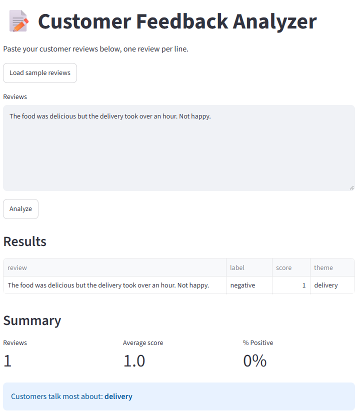
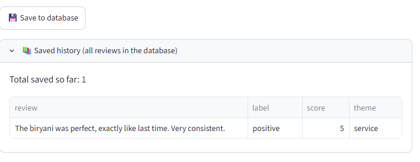

# Feedback Insights

Turn a batch of customer reviews into a **label, a 1–5 score and a theme** for each one, plus a
summary: average score, share of positive reviews and the theme customers mention most. Analysis
runs locally through [Ollama](https://ollama.com), so review text stays on your machine. Results can
be saved to SQLite and reviewed later.

[](https://github.com/corradoisidoro/feedback-insights/actions/workflows/ci.yml)
[](LICENSE)
[](https://www.python.org/)

Python 3.14 · FastAPI · Streamlit · Ollama (`qwen3:0.6b`) · SQLite · uv · pytest · Ruff · mypy



## Why local analysis

Customer feedback is often sensitive, and sending it to a hosted API is a policy decision, not a
default. Every analysis goes to the Ollama instance on `localhost`; no review text leaves the
machine unless you point `OLLAMA_BASE_URL` somewhere else.

## Quickstart

Requires [uv](https://docs.astral.sh/uv/) and a local [Ollama](https://ollama.com/download).

```bash
ollama pull qwen3:0.6b
uv sync
```

Start the API in one terminal:

```bash
uv run uvicorn api:app --reload --port 8000
```

Start the UI in a second terminal:

```bash
uv run streamlit run app.py
```

Open <http://localhost:8501>, press **Load sample reviews**, then **Analyze**. Interactive API docs
are at <http://127.0.0.1:8000/docs>.

`.env` is optional: the defaults match a stock Ollama install. Copy `.env.example` if yours differs.

## Example output

Each line you paste becomes one row, and the summary is computed from the batch:

| Review | Label | Score | Theme |
| --- | --- | --- | --- |
| Food was delicious, but delivery took over an hour. Not happy. | negative | 2 | delivery |
| Prices went up for the same small portion. | neutral | 3 | price |
| Amazing taste, arrived hot and early. Will order again! | positive | 5 | delivery |

```text
Reviews 3 · Average score 3.3 · % Positive 33%
Customers talk most about: delivery
```

This is one illustrative run; exact output depends on the model tag and the review text.

## How it works

```
Streamlit UI (app.py)
        |  POST /analyze {"text": "..."}   one request per review
        v
FastAPI service (api.py)  ->  Ollama  ->  qwen3:0.6b
        |  {label, score, theme}
        v
Streamlit UI  ->  feedback.db (database.py, SQLite)
```

`api.py` asks the model for JSON that matches the `Analysis` schema (`label`, `score`, `theme`), so
the reply is parsed into a validated model rather than hand-checked. The UI keeps results in
`st.session_state` until you press **Save to database**.

## Design decisions and tradeoffs

| Decision | Why now | What I would change at scale |
| --- | --- | --- |
| Streamlit UI | Whole interface in one file; fastest path to a usable tool | React/Next.js for routing, component reuse and a design system |
| One review per synchronous call | Simple to debug, easy to attribute a failure to one review | Queue plus concurrent workers, a batch endpoint and progress polling |
| SQLite | Zero setup, ideal for a single-user demo | Postgres with migrations, indexes and per-customer scoping |
| No authentication | It is a local, single-user tool | Authn/authz, rate limits, per-tenant data isolation |
| Prompt-enforced label and theme | Works with a 0.6b model, no extra machinery | Enum-constrained schema, confidence score, regression eval set |
| Appended rows, no dedupe | Saving twice is visible and recoverable | Idempotency key per analysis, so repeated saves do not duplicate |

## Reliability and failure modes

| Failure | Surfaced as | Why it is handled this way |
| --- | --- | --- |
| Text missing or longer than 2000 characters | `422` | Validated at the boundary, before any model call is paid for |
| Ollama unreachable or timed out | `502` | One clean error contract instead of a hanging UI |
| Model reply does not match the schema | `502` | Structured response plus an explicit `None` check |
| One review fails mid-batch | `error` row, score `0` | The batch continues and the failure stays visible per review |
| Model not loaded yet | Warm-up at startup, `keep_alive` afterwards | Avoids a slow first analysis in a fresh session |

## Model and prompt design

- **Model:** `qwen3:0.6b` through Ollama. Small enough to run on a CPU-only machine, which keeps the
  demo free and private.
- **Output contract:** replies are parsed into the `Analysis` Pydantic model instead of being parsed
  by hand, so a malformed reply fails loudly rather than silently producing a wrong row.
- **Determinism:** `temperature=0` plus an explicit token cap make repeated analyses of the same
  review comparable.
- **Latency:** static instructions come before user text so Ollama can reuse its prompt cache, and
  `keep_alive` keeps the model resident between requests.
- **Guardrails:** the label set and the one-word theme are enforced only by the prompt. Nothing
  rejects an unexpected `label` value, which is why enum constraints are on the next-steps list.

## Evaluation approach

There is no eval harness yet. Because analysis is deterministic (`temperature=0`), quality here can
be measured without a judge model: label agreement, score error and theme match against a small
hand-labeled set. LLM-as-judge evaluation fits free-form generation, not fixed-schema extraction, so
it belongs to a separate RAG project rather than this one.

## API

`POST /analyze`

```bash
curl -X POST http://127.0.0.1:8000/analyze \
  -H "Content-Type: application/json" \
  -d '{"text": "Delivery was fast but the soup arrived cold"}'
```

```json
{"label": "negative", "score": 2, "theme": "delivery"}
```

| Status | When |
| --- | --- |
| `200` | Model returned a usable analysis |
| `422` | `text` missing or longer than 2000 characters |
| `502` | Ollama unreachable, or it returned output that did not match the schema |

## Data

`feedback.db` keeps one row per saved analysis:

| Column | Type | Notes |
| --- | --- | --- |
| `id` | INTEGER | Primary key |
| `review` | TEXT | Original review text |
| `label` | TEXT | `positive`, `negative` or `neutral` (`error` if the call failed) |
| `score` | INTEGER | 1–5, or `0` for failed rows |
| `theme` | TEXT | One lowercase word |

Rows are appended on every save, so pressing save twice stores the same results twice, and there is
no timestamp, so history order is storage order. The database file is git-ignored; delete it to start
over. The saved-history expander in the UI reads the same file:



*Saved history, read straight from `feedback.db`.*

## Configuration

Copy `.env.example` to `.env`; every variable is optional.

| Variable | Used by | Default | Purpose |
| --- | --- | --- | --- |
| `OLLAMA_BASE_URL` | `api.py` | `http://localhost:11434/v1` | OpenAI-compatible endpoint of Ollama |
| `OLLAMA_MODEL` | `api.py` | `qwen3:0.6b` | Model tag to analyze with |
| `OLLAMA_API_KEY` | `api.py` | `ollama` | Placeholder key; Ollama ignores it |
| `OLLAMA_KEEP_ALIVE` | `api.py` | `30m` | How long the model stays loaded between requests |
| `OLLAMA_TIMEOUT_SECONDS` | `api.py` | `30` | Timeout for one model call |
| `OLLAMA_TEMPERATURE` | `api.py` | `0` | Sampling temperature; `0` keeps analysis deterministic |
| `OLLAMA_MAX_TOKENS` | `api.py` | `2048` | Token cap for one analysis |
| `API_URL` | `app.py` | `http://127.0.0.1:8000/analyze` | Where the UI sends reviews |
| `API_TIMEOUT_SECONDS` | `app.py` | `60` | Timeout for one UI request |
| `DB_FILE` | `database.py` | `feedback.db` | SQLite file, resolved against the working directory |

`.env` is git-ignored; never commit it.

## Project layout

| Path | Purpose |
| --- | --- |
| `api.py` | FastAPI app, model prompt (`SYSTEM_PROMPT`), `Analysis` schema, Ollama client |
| `app.py` | Streamlit UI, batch analysis, summary and save button |
| `database.py` | SQLite schema and queries |
| `tests/` | pytest suite covering all three modules |
| `.env.example` | Documented configuration template |
| `pyproject.toml` | Dependencies and ruff/mypy/pytest settings |

The three modules are intentionally small and flat; there is no package to import. If you are
reading the code, start at `SYSTEM_PROMPT` and `Analysis` in `api.py`, then the summary block in
`app.py`.

## How it is built

```bash
uv sync
uv run ruff check .
uv run ruff format --check .
uv run mypy
uv run pytest
```

- Type hints everywhere, with mypy set to `disallow_untyped_defs`.
- Ruff for lint and formatting, enforced in CI.
- 23 tests, 100% statement coverage on the current suite; `pyproject.toml` fails the run below 85%.
- Broad exception handlers exist only at boundaries (the model call, the per-review HTTP call, JSON
  decoding, the startup warm-up) and each carries a comment explaining why.
- The tests use `streamlit.testing.v1.AppTest` and a stubbed `requests.post`, so no network or Ollama
  instance is needed. CI runs the same checks on every push and pull request.

## Troubleshooting

| Symptom | Fix |
| --- | --- |
| UI rows show `error` | API not running, wrong `API_URL`, or Ollama not running (check `http://127.0.0.1:8000/docs`) |
| API returns `502` | Start Ollama and confirm `ollama list` shows the model from `OLLAMA_MODEL` |
| First analysis is slow | The model is loading; startup warms it and `OLLAMA_KEEP_ALIVE` keeps it in memory |
| History stays empty | Results must be analyzed and then saved; the history expander reads the same `feedback.db` |
| Port already in use | Pass another `--port` to uvicorn, or `--server.port` to Streamlit, and update `API_URL` |

## Limitations

- Single user, no authentication, no concurrency control: anything on the network can call the API.
- One review is one model call; long batches are slow on CPU-only machines.
- Saved rows have no timestamp, so history order is storage order.
- `label` and `theme` are only constrained by the prompt; unexpected values are stored and shown as-is.
- No logging or metrics, so a failure is diagnosed from the UI and the API response alone.

## Next steps

Not built yet; listed in the order they would matter.

1. A small labeled eval set with label agreement, score error and theme match, gated in CI.
2. Enum-constrained `label` and `theme`, plus a confidence field, so unexpected values are rejected.
3. `created_at` on saved rows and idempotent saves, so history is ordered and re-saving is safe.
4. Structured logging with request IDs and per-call latency, so failures are observable.
5. Concurrent or batched analysis with progress reporting, replacing one synchronous call per review.
6. Authentication and rate limiting before any non-local deployment.

## License

MIT — see [LICENSE](LICENSE).
